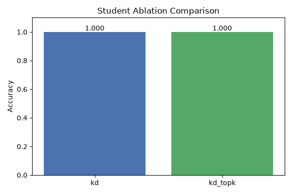

# 实验报告 | MSRD4 Hypergraph RGVQ Distillation

_自动生成于 2026-09-27 07:22 UTC_

## 数据集概要
- 节点数 (|V|): 1200
- 特征维度: 16
- 超边数 (|E|): 800
- 类别数: 6
- 划分: 训练 720 / 验证 240 / 测试 240

## 蒸馏包配置
- Top-K: 3
- Stage × Level: 2 × 2
- Node/Edge 码本规模: 128 / 128

## 训练摘要
- 教师验证准确率: 1.000
- 学生 (KD) 验证准确率: 1.000
- 学生 (KD+TopK) 验证准确率: 1.000

## 测试集结果

| Student | Test Accuracy |
| --- | --- |
| kd | 1.0000 |
| kd_topk | 1.0000 |

